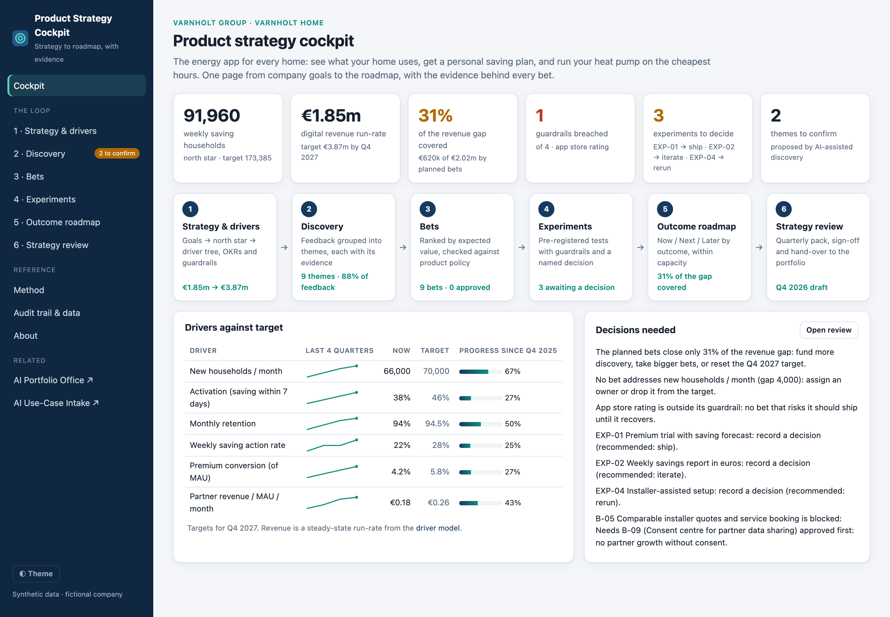
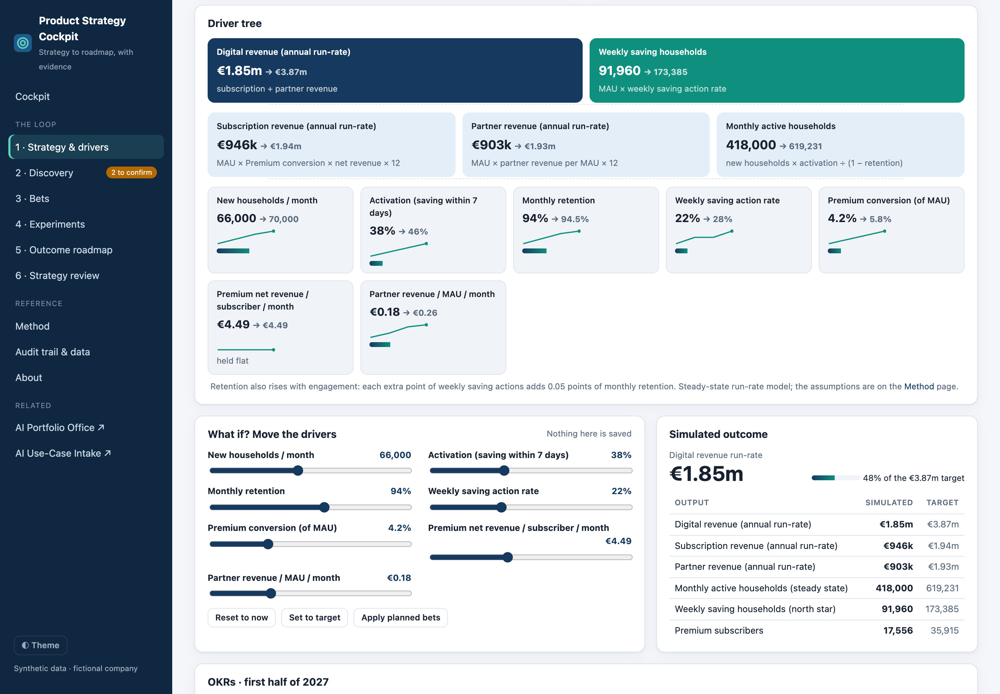
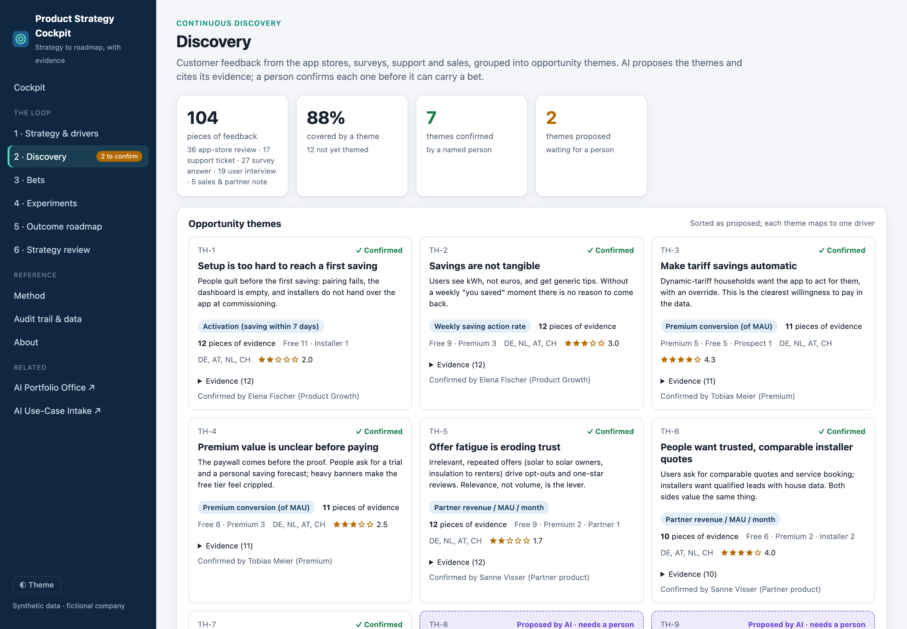
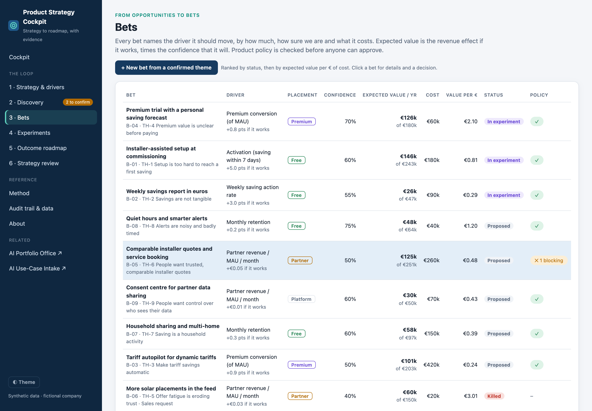
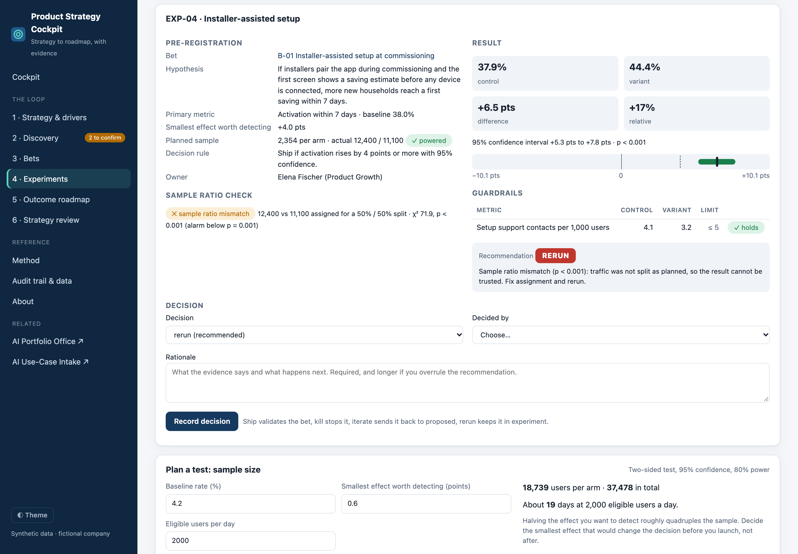
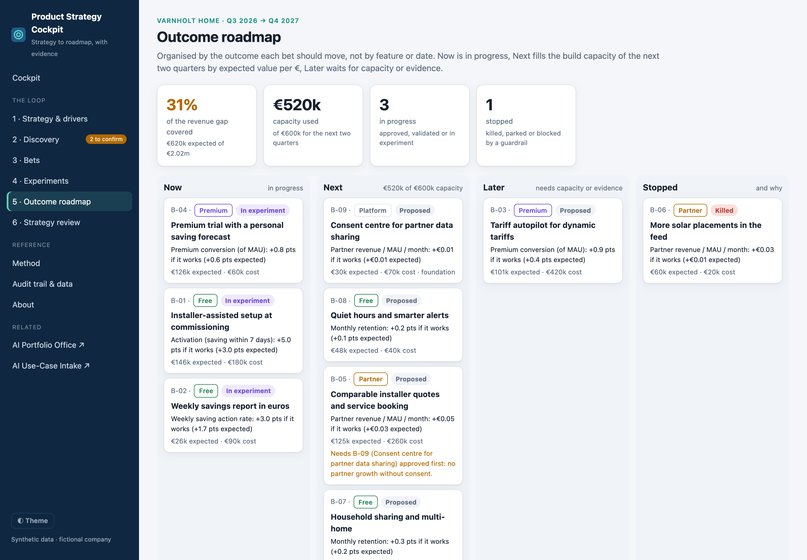
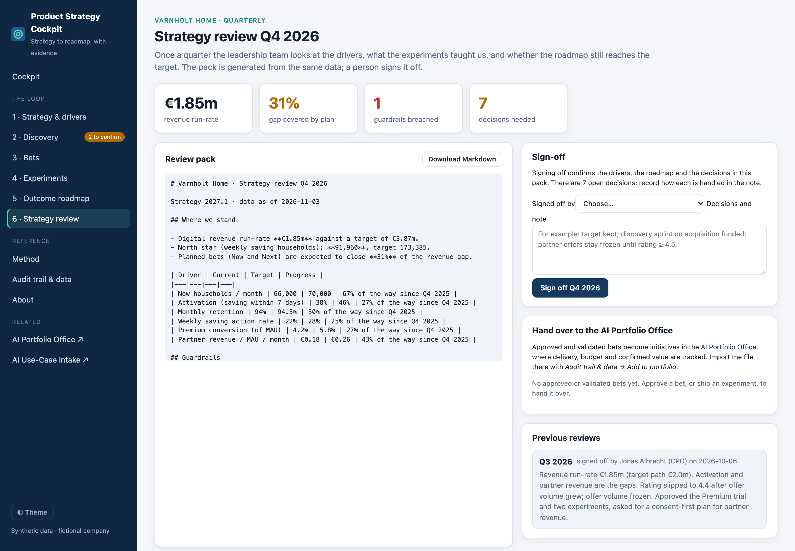

# Product Strategy Cockpit

**From company strategy to an outcome roadmap, with the evidence behind every bet: a driver tree, AI-assisted discovery, bets ranked by expected value, experiments with guardrails, and a quarterly strategy review.**

[**▶ Live demo**](https://geopap.github.io/product-strategy-cockpit/) · [Method](docs/METHOD.md) · AI life cycle: **set product strategy** → decide with [AI Use-Case Intake](https://github.com/geopap/ai-use-case-intake) → build with [Claude Code SDLC](https://github.com/geopap/claude-code-sdlc) → prove with [AI Eval Workbench](https://github.com/geopap/ai-eval-workbench) → govern with [AI Portfolio Office](https://github.com/geopap/ai-portfolio-office)



---

## Why this exists

Most product strategies live in slides, and most roadmaps are feature lists with dates. The chain between them breaks in five places:

- **Strategy and roadmap are disconnected.** Nobody can say which feature moves which number.
- **Discovery is anecdotal.** The loudest quote wins; feedback from app stores, support and sales is never put together.
- **Commercial pressure has no counterweight.** "More offers" always looks good on the metric it targets. The cost shows up later in ratings and trust.
- **Experiments are read generously.** Broken traffic splits, under-powered tests and moved goalposts turn noise into launches.
- **Nobody checks whether the plan adds up.** The roadmap is full, but it would not reach the target even if everything worked.

The cockpit keeps that chain in one place, for a fictional freemium app: **Varnholt Home**, the home-energy app of Varnholt Group. It has a free tier, a €4.99 Premium subscription, and partner offers from installers.

## Who it's for

| | What they get |
|---|---|
| **Product leaders (CPO, Head of Product)** | Strategy translated into a driver tree and OKRs, a roadmap organised by outcome, honest experiment readouts, and a quarterly review that shows whether the plan reaches the target |
| **Commercial leaders** | Subscriptions and partner revenue in the same model as retention and trust, so trade-offs are visible as trade-offs, and requests from Sales get a fair, evidence-based answer |
| **Technology and delivery leaders** | Bets with costs and dependencies on existing platform initiatives, a capacity-bound Next column, and approved bets handed over to portfolio governance |

## The loop

| Step | What happens |
|---|---|
| **1 · Strategy** | Company goals → a **north star** (weekly saving households) → a **driver tree** of seven drivers (new households, activation, retention, engagement, Premium conversion, net revenue, partner revenue). Each driver has history, a target and guardrails. A **what-if simulator** moves the drivers and recalculates revenue and the north star. |
| **2 · Discovery** | 104 pieces of synthetic feedback from app stores, surveys, support, sales and interviews. **AI proposes themes and must cite its evidence**; a named person confirms each theme before it can carry a bet. An optional live run with Claude re-groups the feedback. |
| **3 · Bets** | Each bet names its driver, uplift, confidence and cost. **Expected value** = revenue effect if it works × confidence. **Product policy as code** blocks approval: the first saving is always free, and there is no partner growth without consent. |
| **4 · Experiments** | Pre-registered tests with a sample-size plan, a **sample ratio check**, a confidence interval and **guardrails**. The readout recommends **ship / iterate / kill / rerun**; a named person decides, and overruling the recommendation needs a longer rationale. |
| **5 · Outcome roadmap** | Now / Next / Later / Stopped, organised by outcome. Next is filled to the capacity of the next two quarters by expected value per €, with foundations first. The page says plainly **how much of the revenue gap the plan covers**. |
| **6 · Strategy review** | A quarterly pack generated from the same data: drivers, guardrails, what we learnt, roadmap, decisions needed. A person signs it off. Approved bets **hand over to the AI Portfolio Office** as initiatives. |

### What the demo shows

- **The plan does not add up, and the cockpit says so.** All planned bets together cover about 31% of the revenue gap, and no bet addresses new households. That is a strategy decision for the quarterly review, not something to hide in a roadmap.
- **Sales asked for more solar offers. The guardrails answered.** EXP-03 raised click-through significantly, but offer opt-outs crossed the 8% guardrail and ratings fell. It was killed, and the partner strategy moved from volume to relevance and consent.
- **A great-looking result that must not ship.** EXP-04 shows +6.5 points of activation, but the traffic split is broken (sample ratio mismatch, p < 0.001). The recommendation is to rerun.
- **Policy blocks the shortcut.** The installer-quote marketplace (B-05) cannot be approved until the consent centre (B-09) is.

## AI where it helps, and where it does not

Reading a hundred pieces of feedback is work that AI can take on. Deciding what matters stays with the team.

- **Proposals only.** Themes from the model start as *proposed*; only a named person confirms one, and only confirmed themes can carry bets.
- **Grounded.** Every theme must cite feedback IDs. Invented IDs are dropped, and a theme with fewer than three real pieces of evidence is discarded.
- **Data minimisation.** Emails and phone numbers are redacted before sending.
- **Untrusted input.** Feedback is wrapped as data, and tags inside it are neutralised.
- **No money from the model.** Uplift, confidence and cost are the product team's accountable inputs.
- **Strict output.** A JSON schema, then local re-validation of every value.

## Try it

1. Open the [live demo](https://geopap.github.io/product-strategy-cockpit/). On **Strategy**, move the drivers, then click *Apply planned bets*.
2. On **Discovery**, confirm one of the two themes proposed by AI.
3. On **Experiments**, open EXP-04 and see why a +6.5-point win must be rerun. Record a decision on EXP-01.
4. On **Bets**, try to approve B-05, see which policy blocks it, and approve B-09 first.
5. On **Strategy review**, sign off the quarter and download the approved bets for the [AI Portfolio Office](https://geopap.github.io/ai-portfolio-office/) (*Audit trail & data → Add to portfolio*).

Run it locally (no build step, no dependencies):

```bash
git clone https://github.com/geopap/product-strategy-cockpit.git
cd product-strategy-cockpit
python3 -m http.server 8080      # then open http://localhost:8080
npm test                         # 17 tests: model, policy, statistics, roadmap, AI guardrails, hand-over (Node 20+)
```

## Screenshots

| Driver tree and what-if simulator | AI-assisted discovery with evidence |
|---|---|
|  |  |
| **Bets ranked by expected value, with policy checks** | **Experiment readout: a broken split caught** |
|  |  |
| **Outcome roadmap and gap coverage** | **Quarterly strategy review and hand-over** |
|  |  |

## How it is built

Plain HTML, CSS and JavaScript modules, with no framework, no build step, no backend and no third-party scripts.

```
js/strategy.js    the strategy as data: goals, north star, drivers, guardrails, OKRs, product policy, model assumptions
js/data.js        synthetic feedback, themes, bets, experiments and review history
js/engine.js      driver model, expected value, policy checks, statistics (z-test, CI, SRM, sample size), roadmap, gap coverage
js/llm.js         optional Claude discovery: redaction, strict JSON schema, grounding check
js/handover.js    review pack (Markdown) and Portfolio Office initiatives
js/audit.js       SHA-256 hash-chained audit trail
js/store.js       browser state, full backup and verified restore
tests/            node:test suites, with a mocked Anthropic API
```

Security baseline: a strict Content-Security-Policy, escaping of all output, no third-party code, and an API key held for the browser tab only. See [SECURITY.md](SECURITY.md).

## About

Built by **George Papadongonas**, a product and digital leader focused on **AI value creation**: turning AI from pilots into measurable P&L impact, with the governance, compliance and security that let it scale.

The method draws on established practice: Teresa Torres on continuous discovery, Kohavi, Tang and Xu on trustworthy online experiments, the North Star Framework, and Marty Cagan on outcome-based product operating models. *All data is synthetic. **Varnholt Group** and **Varnholt Home** are fictional. The driver model is illustrative and is not a forecast.*

## License

[MIT](LICENSE)
